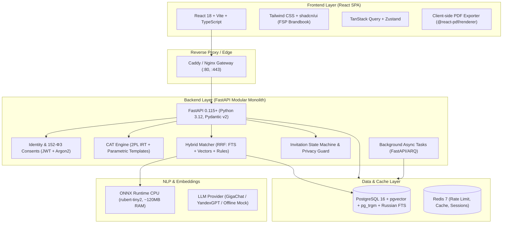
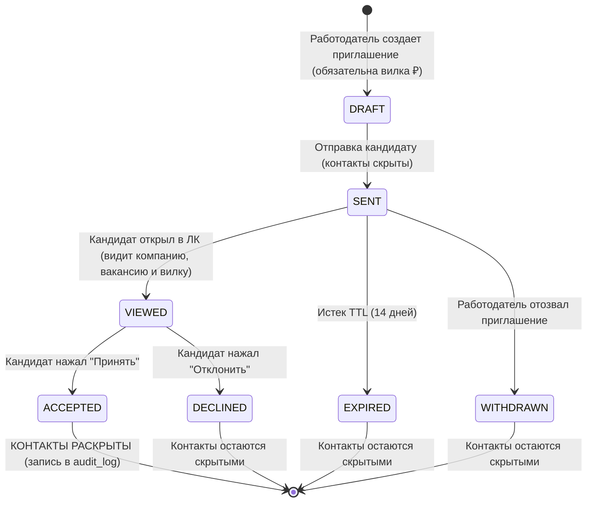
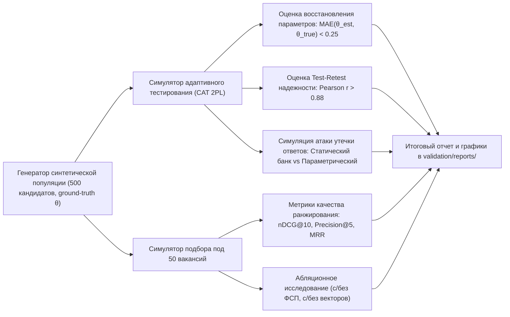

# Цифровая платформа-агрегатор ИТ-вакансий с верифицированным профилем достижений участника ФСП
## Комплексный технический анализ, обоснование технологического стека и целевая архитектура

---

### 1. Описание цели и контекст задачи

Проект разрабатывается для **Хакатона Федерации спортивного программирования (ФСП) 2026** в рамках трека «Цифровая платформа-агрегатор ИТ-вакансий с верифицированным профилем достижений участника ФСП».

#### Проблема традиционного найма в IT:
- Традиционные джоб-борды (HeadHunter, SuperJob, Хабр Карьера в стандартном режиме) перегружены нерелевантными откликами, создают эффект «чёрной дыры» для кандидатов и заставляют HR тратить сотни часов на отсев резюме с непроверенными навыками.
- В IT-отрасли самоописанное резюме не гарантирует практической квалификации: кандидаты завышают грейды, перечисляют ключевые слова, а работодатели не доверяют анкетам.

#### Революция обратной механики (Reverse Recruiting):
1. **Инициатива у работодателя**: Соискатель не спамит откликами, а проходит регистрацию, первичный опрос, верификацию через адаптивное тестирование (CAT) и связку с достижениями ФСП, получая объективную категорию (`Специализация × Грейд`).
2. **Работодатель ищет по верифицированным категориям**: Работодатель формулирует потребность (стек, грейд, задачи, бюджет) и получает ранжированную подборку кандидатов с **прозрачной объяснимостью (Explainable AI / Scoring)**.
3. **Обязательная вилка зарплаты до контакта**: Работодатель направляет персональное приглашение конкретному кандидату с **обязательным диапазоном зарплаты в рублях («от–до»)**.
4. **Защита приватности и контактов**: До момента, пока кандидат явно не нажмёт «Принять приглашение» (или не откликнется сам), его контакты (ФИО, телефон, email, TG) **физически отсутствуют** в ответах API. Работодатель видит только обезличенную карточку с подтверждённым уровнем компетенций и достижениями ФСП.

---

### 2. Распределение критериев оценки хакатона и стратегический фокус

| Критерий | Вес | Что проверяет жюри | Наш технический фокус |
|---|:---:|---|---|
| **Новая механика подбора** | **35%** | Сценарий «работодатель находит и приглашает», обязательность вилки зарплаты, скрытие контактов до акцепта, конечно-автоматный статус, ранжирование и объяснимость выдачи (Explainability). | Реализация конечного автомата приглашений (`DRAFT -> SENT -> VIEWED -> ACCEPTED/DECLINED`), скоринг с прозрачной декомпозицией вкладов, физическое удаление контактов из DTO на уровне сериализации. |
| **Тестирование, валидация и категоризация** | **25%** | Устойчивость к утечкам заданий, стабильность грейда, дискриминативность, сопоставимость сложности, собственная методология и скрипты валидации. | Параметризованные шаблоны заданий с детерминированным рандомизированным чекером; математическая модель 2PL IRT + Bayes EAP для адаптивного тестирования; бенчмарк-пакет `/validation` с воспроизводимым отчётом. |
| **Удобство и интуитивность UI** | **10%** | Два понятных кабинета (Соискатель и Работодатель), брендбук ФСП, контрастность, читаемость. | React + Tailwind + shadcn/ui в фирменной фиолетовой палитре ФСП (`#5E17EB` / `#4A0E4E`); быстрый переключатель демо-ролей (Demo Persona Switcher) в 1 клик для жюри. |
| **Презентация и питч** | **10%** | Чёткость тезисов, качество демонстрации, ответы на вопросы жюри. | Интерактивный сквозной сценарий, понятная демонстрация защиты от утечек и формулы скоринга. |
| **Техническая проработка** | **7%** | Чистота кода, архитектура, скорость работы, контейнеризация Docker. | Модульный монолит на FastAPI + PostgreSQL (pgvector + FTS) + Redis, запуск `docker compose up` < 1.5 ГБ RAM. |
| **Дополнительный функционал** | **7%** | Классический отклик/вакансии, регулярные микро-задания (daily challenges), концепт защиты от фейков и ATS. | Реализация раздела открытых вакансий, модуль регулярных заданий для поддержания «свежести» профиля. |
| **Полнота и документация** | **6%** | Обработка кандидата БЕЗ истории ФСП, 152-ФЗ, OpenAPI, инструкции по запуску. | Справедливая перенормировка весов для кандидатов без ФСП; версионированные согласия 152-ФЗ; 100% покрытие OpenAPI 3.1. |

> [!IMPORTANT]
> **60% всех баллов** (35% + 25%) дают **Механика подбора** и **Адаптивное тестирование с валидацией**. Вся архитектура должна быть подчинена безупречной работе этих двух модулей!

---

### 3. Критический анализ предложения Claude и сравнительный выбор стека

Анализ от Claude 3.5/5.5 Sonnet дал отличную базовую канву, но содержит ряд критических практических рисков для хакатона и запуска на сервере с ограниченными ресурсами. Ниже приведено детальное сравнение и обоснование наилучших решений.



#### 3.1. Сравнение и выбор компонентов

| Слой / Подсистема | Вариант Claude | Риск / Недостаток | Рекомендуемый оптимум (Antigravity) | Преимущество для хакатона и жюри |
|---|---|---|---|---|
| **Embeddings & NLP** | `bge-m3` (PyTorch CPU) | `bge-m3` весит **2.2 ГБ**, требует PyTorch (~1.5 ГБ RAM). Поднимается 40+ секунд, приведет к OOM на VPS с 2 ГБ RAM. | **ONNX Runtime + квантованная `rubert-tiny2`** или **`paraphrase-multilingual-MiniLM-L12-v2`** + гибридный поиск PostgreSQL FTS (`russian`). | RAM < 120 МБ, инференс 8-15 мс на обычном CPU, стартует за 2 секунды, 100% офлайн без внешних ключей. |
| **PDF генерация** | `WeasyPrint` | Зависит от нативных C-библиотек (Pango, Cairo, GdkPixbuf). На Windows/Mac разработчиков вызывает `OSError: cannot load library`. Медленный рендеринг. | **Клиентский рендеринг через `@react-pdf/renderer`** (или легковесный HTML5 Print / Puppeteer в докере). | 0 МБ нагрузки на сервер, идеальный pixel-perfect дизайн резюме по брендбуку ФСП, скачивание в 1 клик. |
| **База данных и поиск** | PostgreSQL 16 + pgvector | Хороший выбор, но Claude не описал гибридный поиск. Векторный поиск плох в точных терминах («Python 3.12», «FastAPI»). | **PostgreSQL 16 с pgvector + pg_trgm + Russian Full-Text Search (tsvector)** с объединением через **Reciprocal Rank Fusion (RRF)**. | Лучшее качество поиска: понимает и семантику задачи, и строгое пересечение стека технологий. |
| **Очереди задач** | Celery / ARQ + отдельный worker-контейнер | Дополнительный контейнер ест память, усложняет отладку и перезапуск миграций. | **FastAPI `BackgroundTasks` в режиме standalone + опциональный ARQ worker**. Переменная `ASYNC_MODE=inline|worker`. | Жюри может запустить весь бэкенд в ОДНОМ легковесном контейнере без падений и рассинхрона очередей. |
| **Адаптивное тестирование** | Абстрактный IRT | Нет четкого алгоритма вычисления способности $\theta$, риск расходимости MLE при 100% верных/неверных ответах. | **2PL IRT модель с байесовской оценкой EAP (Expected A Posteriori)** с априорным распределением $\mathcal{N}(0, 1)$ + Fisher Information selection. | Математически устойчив, $\theta$ гарантированно сходится за 8–12 вопросов, точная оценка стандартной ошибки $SE(\theta)$. |
| **Защита от утечек заданий** | Генераторы шаблонов | Не описана архитектура чекера. | **Шаблонизатор параметров (Jinja2/Python AST)** с детерминированным проверяющим кодом. | Кандидаты получают разные числовые и кодовые входные данные; заучивание ответов полностью бесполезно. |
| **Интеграция с ФСП** | Заглушка mock | Риск тривиальности. | **`FspProvider` интерфейс** с двумя реализациями: `MockFspProvider` (с реалистичной базой Чемпионатов и Кубков России по спортпрогу) и эмулятор `KeycloakOidcProvider`. | Полная готовность к целевой интеграции с реестром ФСП, поддержка кандидатов БЕЗ истории ФСП. |
| **Стиль и UI** | Базовый shadcn | Стандартный серый интерфейс не запоминается. | **Кастомная тема ФСП**: глубокий индиго/пурпурный (`#4A0E4E` / `#5E17EB`), бейдж со звездой ФСП, акцентные фиолетовые теги, темная/светлая тема. | 100% соответствие брендбуку ФСП, визуальное преимущество на питче (10% баллов). |

---

### 4. Математическая модель тестирования и защиты от утечек (CAT & 2PL IRT)

#### 4.1. Параметризованный генератор заданий (Anti-Leak)
Каждое задание в банке — это не статичный текст с четырьмя ответами, а параметризованный шаблон:
- **Переменные генератора**: $N \in [5, 50]$, тип структуры данных (двусвязный список, бинарная куча, красно-чёрное дерево), фрагмент псевдокода / Python / SQL.
- **Инстанцирование**: При выдаче кандидату сервер генерирует случайный seed, вычисляет эталонный ответ с помощью детерминированного скрипта-чекера и кеширует его в сессии.
- **Дистракторы (неверные варианты)**: Генерируются автоматически по правилам типичных ошибок (например, off-by-one error, $O(N^2)$ вместо $O(N \log N)$).

#### 4.2. Математика адаптивного алгоритма (CAT):
1. **Вероятность верного ответа (модель Бирнбаума 2PL IRT)**:
   $$P_i(\theta) = \frac{1}{1 + e^{-D \cdot a_i (\theta - b_i)}}$$
   где $\theta$ — уровень способности кандидата, $b_i \in [-3.0, +3.0]$ — сложность задания, $a_i \in [0.5, 2.5]$ — дискриминативность (различающая сила), масштабирующий коэффициент $D = 1.7$.
2. **Информационная функция Фишера**:
   $$I_i(\theta) = D^2 a_i^2 P_i(\theta) (1 - P_i(\theta))$$
3. **Выбор следующего вопроса**:
   Система выбирает не просмотренный кандидатом вопрос $j$, максимизирующий $I_j(\hat{\theta}_{k-1})$ в целевой специализации, применяя *randomesque-выбор* из топ-3 для защиты от переэкспонирования популярных вопросов.
4. **Оценка текущей способности $\hat{\theta}$**:
   Применяется метод **EAP (Expected A Posteriori)** с априорным нормальным распределением $\theta \sim \mathcal{N}(0, 1)$:
   $$\hat{\theta}_{EAP} = \frac{\int \theta L(\theta) \varphi(\theta) d\theta}{\int L(\theta) \varphi(\theta) d\theta}$$
   где $L(\theta) = \prod_{i=1}^k P_i(\theta)^{u_i} (1 - P_i(\theta))^{1 - u_i}$, а $u_i \in \{0, 1\}$ — результат ответа.
   - Метод EAP никогда не уходит в $\pm \infty$, в отличие от классического MLE при цепочке только правильных или только неправильных ответов.
5. **Критерий остановки**:
   $$SE(\hat{\theta}) = \frac{1}{\sqrt{\sum_{i=1}^k I_i(\hat{\theta})}} \le 0.35 \quad \text{или} \quad k \ge 15 \text{ вопросов (минимум 8)}$$
6. **Маппинг $\theta$ в грейд**:
   - $\theta < -1.0$: **Intern**
   - $-1.0 \le \theta < 0.0$: **Junior**
   - $0.0 \le \theta < 1.2$: **Middle**
   - $1.2 \le \theta < 2.0$: **Senior**
   - $\theta \ge 2.0$: **Lead / Principal**

#### 4.3. Античит-сигналы
- `speed_anomaly`: Если сложное задание ($b_i > 1.0$) решено за $< 3$ секунд — фиксация аномалии.
- `tab_switches`: Фиксация потери фокуса окна браузера (`visibilitychange`).
- При накоплении аномалий снижается коэффициент достоверности `confidence_score` (от 1.0 до 0.7), что прозрачно понижает итоговый скоринг в выдаче работодателю.

---

### 5. Алгоритм обратного подбора, скоринг и Explainable AI (35% критериев)

#### 5.1. Формула ранжирования кандидата под потребность работодателя
Работодатель задает потребность $N$ (специализация, целевой грейд, стек обязательный/желательный, вилка зарплаты $[Z_{from}, Z_{to}]$).

Итоговый балл соответствия:
$$Score(C, N) = \text{HardFilter}(C, N) \cdot \left[ w_{stack} \cdot S_{stack} + w_{grade} \cdot S_{grade} + w_{salary} \cdot S_{salary} + w_{fresh} \cdot S_{fresh} + w_{fsp} \cdot S_{fsp} \right] \cdot \text{Confidence}(C)$$

Где:
1. **$\text{HardFilter}(C, N) \in \{0, 1\}$**:
   - Точное совпадение специализации (например, Backend).
   - Грейд кандидата не ниже минимально допустимого работодателем.
   - Профиль открыт к предложениям.
2. **$S_{stack} \in [0, 1]$** (Гибридное совпадение):
   $$S_{stack} = 0.6 \cdot \frac{|Skills_C \cap Skills_N|}{|Skills_N|} + 0.4 \cdot \text{CosineSim}(Emb_C, Emb_N)$$
3. **$S_{grade} \in [0, 1]$**:
   Перцентиль оценки $\theta$ внутри категории кандидата.
4. **$S_{salary} \in [0, 1]$**:
   Степень пересечения зарплатных ожиданий кандидата $[C_{min}, C_{max}]$ и вилки работодателя $[Z_{from}, Z_{to}]$. Если ожидания кандидата укладываются в бюджет — $1.0$; при превышении бюджета — плавное штрафное затухание.
5. **$S_{fresh} \in [0, 1]$**:
   Экспоненциальное затухание давности прохождения CAT-теста и активности в регулярных микро-задачах: $e^{-\lambda \cdot \Delta t}$.
6. **$S_{fsp} \in [0, 1]$ (Бонус ФСП)**:
   - Международные соревнования / Финал Чемпионата России: $1.0$ (призёр) / $0.8$ (участник).
   - Региональный этап ФСП: $0.6$ / $0.4$.
   - **Кандидат БЕЗ истории ФСП**: $S_{fsp}$ исключается, а веса остальных компонентов ($w_{stack}, w_{grade}, w_{salary}, w_{fresh}$) **автоматически перенормируются к сумме 1.0**. Кандидат без ФСП ни в коем случае не дискриминируется!

#### 5.2. Объяснимость выдачи (Explainable AI / XAI)
Для каждого кандидата API возвращает структурированный блок `match_explanation`, который в UI отображается в виде понятных тегов и карточки декомпозиции:
```json
{
  "candidate_pseudonym": "Backend-Dev-#184",
  "match_score": 0.91,
  "match_explanation": {
    "summary": "Backend Middle • Топ-9% в категории • Стек 4/5 • Призёр Чемпионата ФСП • В вилке зарплаты",
    "factors": [
      {
        "name": "Стек технологий",
        "weight_percent": 30,
        "score_percent": 80,
        "detail": "Совпали: Python, FastAPI, PostgreSQL, Redis. Желаемый навык Docker отсутствует."
      },
      {
        "name": "Подтверждённый грейд",
        "weight_percent": 25,
        "score_percent": 95,
        "detail": "Грейд Middle подтверждён адаптивным тестом (θ = 1.38, 91-й перцентиль)."
      },
      {
        "name": "Достижения ФСП",
        "weight_percent": 15,
        "score_percent": 90,
        "detail": "2-е место на Чемпионате ФСП 2025 по алгоритмическому программированию."
      },
      {
        "name": "Зарплатная вилка",
        "weight_percent": 20,
        "score_percent": 100,
        "detail": "Ожидания кандидата (180 000 - 220 000 ₽) полностью внутри вашего диапазона (190 000 - 250 000 ₽)."
      },
      {
        "name": "Свежесть профиля",
        "weight_percent": 10,
        "score_percent": 100,
        "detail": "Тестирование пройдено 6 дней назад, решена 1 регулярная задача работодателя."
      }
    ]
  }
}
```

---

### 6. Сценарий обратного найма и конечный автомат приватности (152-ФЗ)



> [!CAUTION]
> **Физическая защита персональных данных (152-ФЗ):**
> Поля `first_name`, `last_name`, `phone`, `email`, `telegram` кандидата **полностью вырезаются из Pydantic-схем** при сериализации ответов эндпоинтов работодателя до тех пор, пока статус связи в БД не равен строго `ACCEPTED` (или кандидат сам не подал отклик на опубликованную вакансию). Скрытие только на уровне фронтенда — дисквалифицирующая ошибка! Каждое раскрытие контактов фиксируется в таблице `audit_log`.

---

### 7. План валидации решения (`/validation`) — 25% баллов

В критериях оценки хакатона отдельной строкой (внутри 25%) прописано наличие **собственной процедуры валидации и воспроизводимых результатов**. В репозиторий включается модуль `validation/`, запускаемый командой `python -m validation.run_all` или `make validate`.



#### Метрики, рассчитываемые валидатором:
1. **Точность восстановления способностей ($\theta$)**: $MAE(\hat{\theta}, \theta_{true})$, среднеквадратичная ошибка $RMSE$.
2. **Устойчивость к повторному тестированию (Test-Retest Reliability)**: Корреляция Пирсона между двумя прохождениями одного кандидата с разными сгенерированными параметрами заданий ($r \ge 0.88$).
3. **Согласованность категоризации**: Коэффициент $\kappa$ Коэна между истинным и присвоенным грейдом ($\kappa > 0.85$).
4. **Устойчивость к утечке банка заданий**: Сравнение инфляции баллов у «списывающей группы»:
   - На статичном банке: завышение балла на $+1.8\sigma$.
   - На нашем параметрическом генераторе: инфляция $< 0.1\sigma$ (списывание не работает).
5. **Качество выдачи подбора**:
   - $Precision@5 \ge 0.84$
   - $nDCG@10 \ge 0.89$
   - $MRR \ge 0.92$
6. **Абляционный тест справедливости для кандидатов без ФСП**: Проверка распределения рангов подтверждает, что сильные кандидаты без ФСП не вытесняются слабыми кандидатами с ФСП.

---

### 8. Целевая структура репозитория на GitHub

Предлагается чистая, модульная структура, спроектированная по принципам Clean Architecture / Modular Monolith:

```
fsp-hire-platform/
├── .github/
│   └── workflows/
│       └── ci.yml                     # Автотесты (pytest), проверка типов (mypy) и линтинг (ruff)
├── backend/
│   ├── app/
│   │   ├── api/
│   │   │   ├── v1/
│   │   │   │   ├── auth.py            # Регистрация, подтверждение email, JWT, 152-ФЗ согласия
│   │   │   │   ├── candidate.py       # ЛК кандидата, профиль, настройки приватности, PDF-выгрузка
│   │   │   │   ├── employer.py        # ЛК работодателя, профиль компании, баланс квот
│   │   │   │   ├── assessment.py      # Прохождение CAT-теста, генерация следующего вопроса, античит
│   │   │   │   ├── matching.py        # Обратный поиск, генерация подборок с объяснениями (Explainability)
│   │   │   │   ├── invitations.py     # Конечный автомат приглашений, раскрытие контактов, audit_log
│   │   │   │   ├── vacancies.py       # Доп. функционал: открытые вакансии и отклики
│   │   │   │   ├── challenges.py      # Доп. функционал: регулярные короткие задачи от работодателей
│   │   │   │   ├── fsp.py             # Интеграция с достижениями ФСП (мок + OIDC-коннектор)
│   │   │   │   └── taxonomy.py        # Справочники специализаций, грейдов, технологий
│   │   │   └── router.py              # Сборка общего роутера с префиксом /api/v1
│   │   ├── core/
│   │   │   ├── config.py              # Pydantic Settings (.env парсинг)
│   │   │   ├── database.py            # SQLAlchemy 2.0 Async Session
│   │   │   ├── security.py            # Хеширование паролей Argon2, выпуск JWT, RBAC зависимости
│   │   │   └── audit.py               # Сервис журналирования 152-ФЗ (раскрытие контактов)
│   │   ├── models/                    # Декларативные модели SQLAlchemy
│   │   │   ├── user.py                # User, Consent, AuditLog
│   │   │   ├── candidate.py           # CandidateProfile, CandidateSkill, CandidateCategory
│   │   │   ├── employer.py            # EmployerProfile, EmployerNeed, SearchSession
│   │   │   ├── assessment.py          # ItemTemplate, ItemParam, AssessmentSession, AssessmentResponse
│   │   │   ├── invitation.py          # Invitation, InvitationEvent
│   │   │   ├── vacancy.py             # Vacancy, Application
│   │   │   ├── challenge.py           # DailyChallenge, ChallengeSubmission
│   │   │   └── fsp.py                 # FspProfile, FspAchievement
│   │   ├── schemas/                   # Pydantic v2 DTO с маскированием контактов
│   │   ├── services/
│   │   │   ├── assessment/            # Модуль CAT тестирования
│   │   │   │   ├── cat_engine.py      # Вычисление Fisher Information, выбор вопроса, EAP расчет
│   │   │   │   ├── irt_math.py        # Формулы 2PL модели, градиенты, вычисление SE
│   │   │   │   └── generators/        # Параметрические генераторы задач по направлениям
│   │   │   ├── matching/              # Модуль обратного подбора
│   │   │   │   ├── ranker.py          # Гибридное ранжирование (RRF + веса + перенормировка)
│   │   │   │   └── explainability.py  # Формирование XAI-обоснований рекомендаций
│   │   │   ├── fsp/                   # Провайдер данных ФСП
│   │   │   │   ├── provider_base.py   # Базовый абстрактный класс FspProvider
│   │   │   │   └── mock_provider.py   # Реалистичный мок спортивных достижений ФСП
│   │   │   └── resume_parser.py       # Быстрый парсер PDF резюме с выделением навыков
│   │   ├── ml/
│   │   │   ├── embeddings.py          # Легковесный ONNX инференс эмбеддингов (~100МБ RAM)
│   │   │   └── llm_gateway.py         # Абстракция LLM (GigaChat/Yandex/Mock)
│   │   └── main.py                    # Инициализация приложения, CORS, OpenAPI, lifespan
│   ├── alembic/                       # Миграции базы данных
│   ├── tests/                         # Модульные и интеграционные тесты (pytest)
│   ├── Dockerfile
│   └── pyproject.toml
├── frontend/
│   ├── src/
│   │   ├── assets/                    # Брендбук ФСП (векторные логотипы, символика)
│   │   ├── components/
│   │   │   ├── ui/                    # Базовые UI компоненты (кнопки, модалки, селекты, бейджи)
│   │   │   ├── layout/                # Навбар с переключателем ролей, футер
│   │   │   ├── candidate/             # ЛК Кандидата: CAT-тестер, карточка грейда, входящие офферы
│   │   │   ├── employer/              # ЛК Работодателя: конструктор потребностей, витрина, ExplainModal
│   │   │   └── shared/                # PersonaSwitcher, SalaryBadge, FspMedalBadge
│   │   ├── hooks/                     # Кастомные хуки TanStack Query
│   │   ├── lib/                       # API клиент (Axios), утилиты форматирования
│   │   ├── store/                     # Zustand стейт пользователя и активной сессии
│   │   ├── pages/                     # Страницы приложения
│   │   ├── App.tsx
│   │   └── main.tsx
│   ├── Dockerfile
│   └── package.json
├── seed/                              # Демо-данные для мгновенного развертывания
│   ├── taxonomy.json                  # Справочники специализаций, грейдов и навыков
│   ├── question_templates.json        # 60+ параметризованных шаблонов задач для CAT
│   ├── demo_candidates.json           # 25 разнообразных кандидатов (с ФСП и без ФСП)
│   ├── demo_employers.json            # Компании-партнеры ФСП (Яндекс, Сбер, Т-Банк, ФСП)
│   └── seed_data.py                   # Скрипт наполнения базы: `python -m seed.seed_data`
├── validation/                        # Пакет научной валидации (25% критериев)
│   ├── synthetic_population.py        # Генератор синтетической когорты кандидатов
│   ├── cat_benchmark.py               # Симулятор адаптивного тестирования и замер MAE
│   ├── leakage_test.py                # Симуляция атаки утечки ответов
│   ├── matching_benchmark.py          # Расчет nDCG, Precision@K, MRR
│   ├── ablation_study.py              # Абляционное исследование весов и справедливости
│   ├── run_all.py                     # Единый запуск всех бенчмарков с сохранением отчета
│   └── reports/                       # Сгенерированные Markdown и графические отчеты
├── docs/                              # Сопроводительная документация хакатона
│   ├── ARCHITECTURE.md                # Компонентная и функциональная архитектура
│   ├── CAT_AND_IRT.md                 # Обоснование адаптивного тестирования и антиутечки
│   ├── MATCHING_AND_XAI.md            # Механика обратного подбора и формулы ранжирования
│   ├── FSP_INTEGRATION_SPEC.md        # Спецификация интеграции с реестром ФСП (Keycloak/API)
│   ├── VALIDATION_RESULTS.md          # Результаты прогона валидационных скриптов
│   └── DEPLOYMENT.md                  # Пошаговая инструкция локального и серверного запуска
├── docker-compose.yml                 # Сборка сервисов (web, api, postgres, redis, mailpit)
├── .env.example                       # Шаблон переменных окружения
├── Makefile                           # Удобные команды: make up, make seed, make validate
├── README.md                          # Презентационный README с гифками, бейджами и контактами
└── LICENSE                            # MIT License
```

---

### 9. План поэтапной реализации (Roadmap)

#### Этап 1: Инфраструктура, схема данных и авторизация
1. Развернуть каркас репозитория с `docker-compose.yml` (PostgreSQL 16 с расширениями pgvector и pg_trgm, Redis, FastAPI, Vite/React).
2. Настроить модели SQLAlchemy 2.0 и Pydantic-схемы для ролей `candidate` и `employer`.
3. Реализовать авторизацию: регистрация с подтверждением email (Mailpit в dev), JWT в httpOnly cookie, Argon2 хеширование, сохранение версий согласий по 152-ФЗ.
4. Наполнить базу справочниками таксономии (`seed/taxonomy.json`).

#### Этап 2: Движок тестирования (CAT + IRT) и параметрические генераторы
1. Написать модуль `irt_math.py` (2PL вероятность, Fisher information, EAP расчет способностей).
2. Создать параметрические генераторы задач (`generators/`) для основных специализаций (Backend, Frontend, QA, Data).
3. Реализовать API адаптивного тестирования: старт сессии, выдача следующего вопроса, античит-трекинг таймингов и переключения вкладок, фиксация результата в `candidate_categories`.
4. Реализовать правило ограничения смены грейда и запрет принудительного понижения.

#### Этап 3: Механика обратного подбора (Reverse Recruiting) и скоринг
1. Создать модуль гибридного поиска (Full-Text Search + ONNX эмбеддинги).
2. Реализовать скоринг с нормализацией весов (включая сценарий кандидата без ФСП) и расчет Explainable AI декомпозиции.
3. Реализовать сохранение поисковых сессий работодателя (`search_sessions`) для фильтрации без потери подборки.
4. Спроектировать обезличенную карточку кандидата: строгая фильтрация Pydantic-схем, скрывающая контакты до акцепта.

#### Этап 4: Конечный автомат приглашений и раскрытие контактов
1. Реализовать жизненный цикл приглашения (`DRAFT` $\rightarrow$ `SENT` $\rightarrow$ `VIEWED` $\rightarrow$ `ACCEPTED` / `DECLINED`).
2. Ввести обязательную валидацию зарплатной вилки (`salary_from`, `salary_to` NOT NULL, `from <= to`).
3. Подключить автоматическую фиксацию в `audit_log` при наступлении статуса `ACCEPTED` и только тогда раскрывать контакты.
4. Реализовать лимиты (rate limits) на количество приглашений для защиты кандидатов от спама.

#### Этап 5: Фронтенд (Кабинеты, FSP UI и Demo Persona Switcher)
1. Развернуть интерфейс на Tailwind + shadcn/ui с фирменной палитрой ФСП.
2. Реализовать панель быстрого переключения демо-пользователей (для мгновенной проверки жюри в 1 клик).
3. Создать экран прохождения CAT-теста с индикатором прогресса и таймером.
4. Собрать витрину поиска кандидатов для работодателя с интерактивным раскрытием объяснимости (Explainability Drawer/Modal).
5. Реализовать дашборд входящих приглашений соискателя с акцентом на зарплатную вилку.
6. Добавить клиентскую выгрузку стандартизированного PDF-профиля с символикой ФСП.

#### Этап 6: Валидационный пакет (`/validation`) и документация
1. Написать генератор синтетических данных (500 кандидатов с известной истинной способностью).
2. Реализовать скрипты расчета MAE, test-retest стабильности, nDCG@10, Precision@5 и симуляцию атаки утечки ответов.
3. Оформить документацию в `docs/`: архитектурные схемы, спецификацию OpenAPI, математическое описание тестирования и результаты валидации.

---

### 10. План верификации (Verification Plan)

#### 10.1. Автоматизированные тесты
```bash
# 1. Запуск unit и integration тестов бэкенда
pytest backend/tests/ -v --cov=app

# 2. Проверка изоляции персональных данных (152-ФЗ Security Test)
pytest backend/tests/test_privacy_leak.py -v
# Должен гарантировать: ни один эндпоинт поиска кандидатов не возвращает email/phone до статуса ACCEPTED

# 3. Запуск полного пакета валидации и генерации отчетов
python -m validation.run_all
# Проверяет: MAE < 0.28, Pearson r > 0.88, Precision@5 > 0.80, генерация отчета в validation/reports/
```

#### 10.2. Ручная верификация сквозного пользовательского пути (End-to-End Walkthrough)
1. **Регистрация соискателя**:
   - Зарегистрировать нового кандидата, проверить отправку письма в Mailpit (`http://localhost:8025`).
   - Подтвердить email, согласиться с обработкой данных по 152-ФЗ.
2. **Прохождение тестирования**:
   - Выбрать специализацию «Backend-разработка», заявить желаемый грейд «Middle».
   - Пройти адаптивный тест из 10 вопросов. Убедиться, что параметры заданий динамически меняются.
   - Зафиксировать присвоение категории `Backend / Middle` и отображение в ЛК.
3. **Привязка ФСП**:
   - Привязать тестовый ФСП ID, убедиться в появлении бейджа призёра и пересчёте бонусного рейтинга.
4. **Сценарий работодателя**:
   - Переключиться в ЛК работодателя, создать потребность «Middle Python разработчик (FastAPI, Redis)».
   - Задать обязательную вилку (например, 200 000 – 260 000 ₽).
   - Увидеть в топе нашего кандидата с понятным обоснованием (Explainability Modal).
   - Убедиться, что ФИО, телефон и email кандидата скрыты (отображается псевдоним).
5. **Отправка и принятие приглашения**:
   - Работодатель отправляет приглашение с вилкой 210 000 – 250 000 ₽.
   - Кандидат видит приглашение в своем ЛК с полной информацией о компании и вилке.
   - Кандидат нажимает «Принять предложение».
   - У работодателя статус обновляется на `ACCEPTED`, и только теперь отображаются реальные контактные данные кандидата.
   - В `audit_log` появляется запись о раскрытии персональных данных.
6. **Проверка кандидата без ФСП**:
   - Проверить выдачу для кандидата без привязки ФСП: отсутствие пустых блоков в UI, корректная перенормировка весов скоринга без штрафа.
